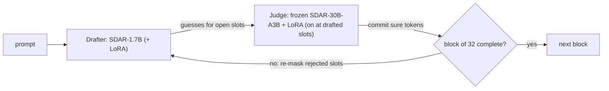

# sdar30b-draft-judge

Faster decoding for the 30B block-diffusion MoE **JetLM/SDAR-30B-A3B-Chat-b32**, without retraining it. A small dense
**drafter** fills each block of 32 tokens with guesses, and a tiny LoRA **judge** on the frozen 30B decides which
guesses to keep. Fewer 30B passes per block means a faster answer at about the same accuracy.

Everything is in one place. One link for all of it: the Hugging Face collection
[sdar30b-draft-judge](https://huggingface.co/collections/Anupam-Rawat-IITB/sdar30b-draft-judge-6ade42e18e3e2ca978d1d560).

| What | Where |
|---|---|
| Code, setups, results (this repo) | `github.com/NoviceCoderInfinity/sdar30b-draft-judge` |
| **Model 1: judge** (LoRA on the 30B) | [Anupam-Rawat-IITB/SDAR-30B-judge-LoRA](https://huggingface.co/Anupam-Rawat-IITB/SDAR-30B-judge-LoRA) |
| **Model 2: drafter** (SDAR-1.7B + LoRA, merged) | [Anupam-Rawat-IITB/SDAR-1.7B-drafter-LoRA](https://huggingface.co/Anupam-Rawat-IITB/SDAR-1.7B-drafter-LoRA) |
| Data: corpus, samples, every eval record, all checkpoints and logs | [Anupam-Rawat-IITB/sdar30b-draft-judge-data](https://huggingface.co/datasets/Anupam-Rawat-IITB/sdar30b-draft-judge-data) |

## Quick start

```bash
# from nothing to a working setup, in one command (Linux + NVIDIA GPUs, ~80 GB disk)
curl -sL https://raw.githubusercontent.com/NoviceCoderInfinity/sdar30b-draft-judge/main/get.sh | bash -s phase4-rd1

# then evaluate any setup on any benchmark (or "all"), sharded over your GPUs
cd sdar30b-draft-judge && . env.sh
./run.sh phase4-rd1 gsm8k500
./run.sh vanilla all --gpus "0 1 2 3"

# just the weights of one model
hf download Anupam-Rawat-IITB/SDAR-30B-judge-LoRA --include "adapter*"
hf download Anupam-Rawat-IITB/SDAR-1.7B-drafter-LoRA --exclude "training/*"

# a phase's full data (corpus, training inputs, checkpoints, records), into the paths its scripts expect
bash scripts/fetch_data.sh phase4 --into-repo
```

`bash setup.sh --list` prints the setups. Each one is a file in `setups/` holding the exact decode flags.

## How it works

```
                 prompt
                   │
   ┌───────────────┴──────────── for each block of 32 tokens ──────────────────────────────┐
   │                                                                                        │
   │  ① DRAFTER   SDAR-1.7B (+ Phase 4 LoRA, merged)    fills every open slot with a guess  │
   │                 │                                                                      │
   │                 ▼                                                                      │
   │  ② JUDGE     SDAR-30B-A3B, frozen MoE (48 layers × 128 experts, top-8)                 │
   │              + judge LoRA, switched on only at drafted slots                           │
   │              → commits the tokens it is sure of (threshold 0.95)                       │
   │                 │                                                                      │
   │                 ▼                                                                      │
   │  ③ rejected slots go back to [MASK]; the drafter re-drafts them                        │
   │     rd1: after every judge pass · rd2: after every second pass (Phases 3 and 4)        │
   │     repeat ② and ③ until all 32 tokens are committed  ───────────────►  next block      │
   └────────────────────────────────────────────────────────────────────────────────────────┘
   Cost is dominated by 30B passes: each one loads ~1,000 experts per token. Vanilla needs 12.8 passes
   per block on average; Phase 4 needs 7.7.
```



## The two models

**Judge (Phase 1).** A LoRA (rank 32, alpha 64) on q, k, v and o of all 48 layers of the frozen SDAR-30B-A3B, 26.7M
parameters, plus a per-position "draft flag". The adapter is active only at positions holding a drafter guess; at
every other position the model is bit-identical to the base, which is why it is never merged. It was trained on
128M tokens of the 30B's own checked answers (maths, code, chat, instruction following, science; corpus waves A and
B), each block replayed with the stock 1.7B's drafts. It learns to commit the tokens the 30B would have produced
anyway, so a block finishes in fewer 30B passes: 12.8 → 9.7 per block, at 65.0% accuracy vs vanilla's 65.5% over
seven benchmarks.

**Drafter (Phase 4).** A LoRA (rank 32, alpha 64) on attention and MLP of all 28 layers of SDAR-1.7B, 34.9M parameters,
trained on the same corpus (331,818 items) to write what the 30B writes, with a small KL term that keeps it close to
the original drafter. It is merged into a full bf16 checkpoint. With the judge and rd1 / rd2 re-drafting it needs
7.6% / 5.3% fewer drafter forwards than Phase 3 and decodes **1.25× / 1.26× faster than vanilla per answer**,
measured on one machine over 2,250 questions, with accuracy within 1.3 points of vanilla.

## The five phases

| Phase | What it did | New weights | Result (all 7 benchmarks, 2,250 questions) |
|---|---|---|---|
| 1 | Trained the judge | judge | passes/block 12.8 → 9.7; compute 1.12× vs vanilla; accuracy 65.0 vs 65.5 |
| 2 | Swapped in released drafters (CoDA-1.7B, Qwen3-0.6B), judge frozen, no training | — | accuracy unchanged (p = 0.77, 0.63); compute 1.09× / 1.15× vs SDAR-1.7B's 1.12× |
| 3 | Re-drafting between judge passes (rd1, rd2) | — | passes/block 7.6 / 8.0; **1.20× / 1.26×** faster than vanilla (wall-clock) |
| 4 | Trained the drafter | drafter | passes/block 7.7 / 7.8; **1.25× / 1.26×** faster than vanilla (wall-clock, measured) |
| 5 | Retrained the judge on fresh recorded states | (failed) | outputs loop: IFEval 1.7% vs 48.1% on the same items; the Phase 1 judge stays |

Full tables per benchmark, the definitions and the Phase 5 failure analysis: [RESULTS.md](RESULTS.md).

## Setups

| Setup | Drafter | Judge | Re-draft |
|---|---|---|---|
| `vanilla` | — | — | — (stock decode) |
| `phase1` | SDAR-1.7B | judge | — |
| `phase2-coda` | CoDA-1.7B | judge | — |
| `phase2-qwen3` | Qwen3-0.6B diffusion | judge | — |
| `phase3-rd1` / `phase3-rd2` | SDAR-1.7B | judge | every pass / every second pass |
| `phase4-rd1` / `phase4-rd2` | **trained drafter** | judge | every pass / every second pass, rejected tokens banned |
| `phase5-rd1` | trained drafter | Phase 5 judge (failed) | every pass |

## Repository map

```
get.sh  setup.sh  run.sh        one-command bootstrap, setup, evaluation
setups/                         one file per setup: the exact decode flags
scripts/summarize.py            accuracy / passes per block / experts per token / seconds from run records
scripts/fetch_data.sh           a phase's data from the HF data repo
env/requirements.txt            exact package pins of the last run (torch 2.11.0 cu128, transformers 4.54.1)
code/draftalign/                the decoder (run_da_decode.py, da_decode.py), judge adapter, scoring
code/corpus1b/                  corpus generation (SGLang), judge training (train_c1b.py)        Phase 1
code/phase2/                    released-drafter registry and wrappers                            Phase 2
code/phase3/, code/phase3_8gpu/ re-draft runs and analysis                                        Phase 3
code/drafter_lora/              drafter LoRA trainer, merge, gates, same-machine speed            Phase 4
code/judge_round/, code/loop_guard/   judge retraining on recorded states (SGLang port)           Phase 5
docs/                           design and run documents of every phase; docs/history/ = earlier top-level docs
results/                        per-phase reports and tables
model_cards/                    the Hugging Face cards
```

Tags `phase1` … `phase5` point at the exact code behind each phase's numbers (one snapshot commit each). `main` is
the Phase 5 code plus Phase 1's training scripts, with the new setup layer on top.

## Resume training or data generation

Every checkpoint is complete (adapter + optimizer state + token count), so any run can continue where it stopped.

| Phase | Data | Entry point |
|---|---|---|
| 1, judge | `bash scripts/fetch_data.sh phase1 --into-repo`; checkpoints in the judge repo's `checkpoints/` | `code/corpus1b/train_c1b.py --continue-from <ckpt>` (`code/corpus1b/ops/train_128m.sh`); corpus generation: `docs/CORPUS_1B_BUILD.md`, `docs/history/` Phase 1 notes |
| 4, drafter | `bash scripts/fetch_data.sh phase1 --into-repo` (corpus), drafter repo `training/` | `bash code/drafter_lora/p4.sh train` (`docs/PHASE4_DRAFTER_LORA.md`) |
| 5, judge retrain | `bash scripts/fetch_data.sh phase5 --into-repo` | `docs/PHASE5_RESUME.md` |

## Credits and license

Joint work of **Anupam Rawat** and **Arush** (Hugging Face: [Arushhh](https://huggingface.co/Arushhh)), whose original
per-phase backups these repos consolidate. Base models: [JetLM/SDAR-30B-A3B-Chat-b32](https://huggingface.co/JetLM/SDAR-30B-A3B-Chat-b32)
and [JetLM/SDAR-1.7B-Chat-b32](https://huggingface.co/JetLM/SDAR-1.7B-Chat-b32) (Apache-2.0). This repository and
the weights: Apache-2.0.
